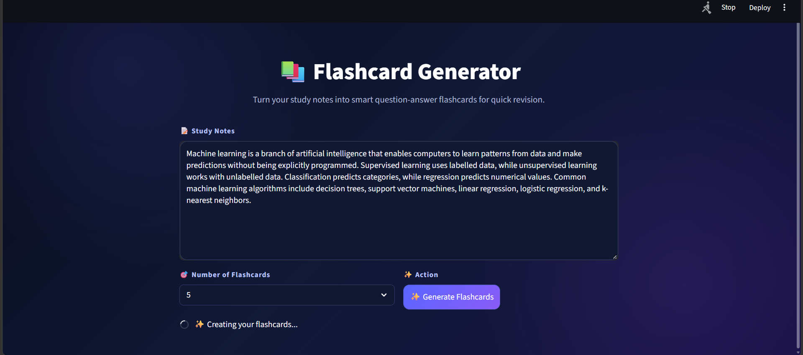
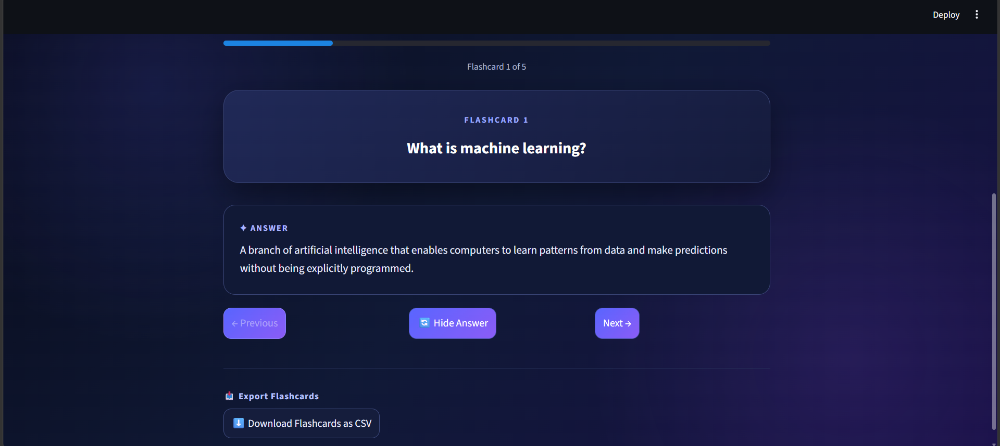

# 📚 Flashcard Generator

## 📌 Problem Statement

Students often deal with large volumes of study material and need quick, effective revision tools. The **Flashcard Generator** uses a Large Language Model (Google Gemini) to automatically transform raw study notes into structured question-answer flashcards. Users can review cards interactively through a Streamlit web interface and export their decks as a downloadable CSV file.

---

## 🚀 How to Run

1. **Clone the repository:**
   ```bash
   git clone https://github.com/LatikaMadankar/llm-ps22-22.git
   cd llm-ps22-22
   ```

2. **Install the required dependencies:**
   ```bash
   pip install -r requirements.txt
   ```

3. **Configure your Gemini API key:**
   Create a `.env` file in the project root directory and add your key:
   ```env
   GEMINI_API_KEY=your_api_key_here
   ```

4. **Launch the Streamlit application:**
   ```bash
   streamlit run app.py
   ```
   Or
   ```bash
   python -m streamlit run app.py
   ```

---

## 📸 Screenshots

### 1. Flashcard Generation


### 2. Answer Reveal & CSV Export

